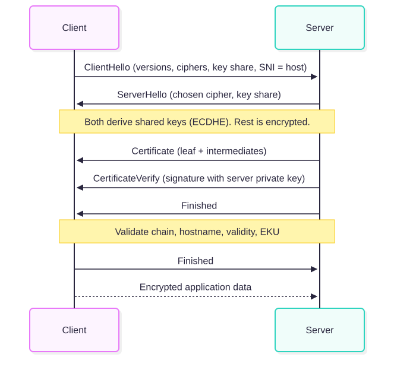
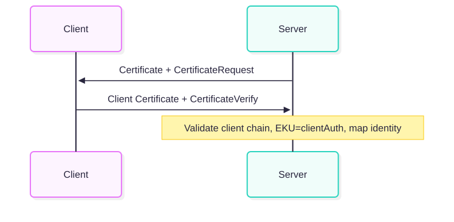

# 4. TLS and mTLS Flow

**Goal:** see exactly where certificates are presented and checked in a connection.

## Key ideas

TLS gives a connection **confidentiality, integrity, and authentication**. Certificates provide the authentication part.

### Simplified TLS 1.3 handshake (server auth)



What each part does:
- **SNI**: the client says which hostname it wants, so a server hosting many names can pick the right certificate. SNI is sent unencrypted, so observers can see the hostname unless Encrypted Client Hello (ECH) is used.
- **Key shares (ECDHE)**: produce fresh session keys. This gives forward secrecy; stealing the server key later does not decrypt past traffic.
- **Certificate**: the server's chain.
- **CertificateVerify**: the server signs the handshake transcript with its **private key**. This is the proof of possession; a copied certificate alone is useless to an attacker.
- **Client validation**: the checks from [chapter 3](03-trust-and-chains.md), including verification of the certificate and `CertificateVerify`, happen before the client accepts the handshake. Failure means the connection must be aborted.

This diagram omits protocol details and optional features such as session resumption, 0-RTT, and ALPN. TLS provides an authenticated peer only when the relevant certificate authentication is enabled and successfully validated.

### The handshake step by step, from the client's point of view

1. **ClientHello.** The client sends the TLS versions and ciphers it supports, the hostname it wants (SNI), and a **key share**: the public half of a fresh, temporary key-exchange key pair. At this point the client knows nothing about the server.
2. **ServerHello.** The server picks the version and cipher and sends its own key share. Each side now combines its private half with the other side's public half and gets the **same shared secret** (Diffie-Hellman, [chapter 1](01-crypto-foundations.md#key-exchange-and-forward-secrecy)). From here on, everything is encrypted. **The client still does not know who it is talking to:** an attacker in the middle could have done the same exchange.
3. **Certificate.** The server sends its leaf certificate and intermediates. On its own this proves nothing, because certificates are public and anyone can copy and replay one.
4. **CertificateVerify.** The server signs the **transcript** (a hash of every handshake message so far, including both key shares) with the private key that matches the certificate. This is the step that defeats the attacker. A replayed certificate is useless without the private key, and because the signature covers this connection's key shares, it cannot be reused on another connection.
5. **Server Finished.** A MAC over the whole transcript, keyed from the shared secret. It confirms both sides saw the same messages and derived the same keys, so nothing was altered along the way.
6. **Client checks.** The client validates the chain to a trusted root, the hostname against the SAN, the dates, and the EKU ([chapter 3](03-trust-and-chains.md#path-validation)). It verifies the CertificateVerify signature with the leaf's public key and checks Finished. **Any failure aborts the connection.**
7. **Client Finished, then application data.** Only now does the client send its HTTP request, encrypted with keys derived from the shared secret.

In short: **the key exchange makes the channel private, the certificate says who the server claims to be, and CertificateVerify proves it.** Encryption without steps 4 and 6 is a private conversation with whoever answered.

### Follow one connection

Here is real output from `openssl s_client` against the server you build in the [hands-on lab](11-hands-on-lab.md), trimmed and annotated:

```sh
openssl s_client -connect localhost:8443 -servername localhost -CAfile root.pem </dev/null
```

```text
depth=2 CN=Lab Root CA            ← (1) validation, from the trust anchor down
verify return:1
depth=1 CN=Lab Intermediate CA
verify return:1
depth=0 CN=localhost
verify return:1
---
Certificate chain                 ← (2) what the server actually sent
 0 s:CN=localhost                     s: = subject, i: = issuer
   i:CN=Lab Intermediate CA
   a:PKEY: EC, (prime256v1); sigalg: ecdsa-with-SHA256
   v:NotBefore: Nov  5 09:51:22 2026 GMT; NotAfter: Dec  5 09:51:22 2026 GMT
 1 s:CN=Lab Intermediate CA
   i:CN=Lab Root CA
   ...
---
Peer signature type: ecdsa_secp256r1_sha256   ← (3) the CertificateVerify signature
Negotiated TLS1.3 group: X25519MLKEM768       ← (4) the key exchange (hybrid post-quantum)
---
Verification: OK
---
New, TLSv1.3, Cipher is TLS_AES_256_GCM_SHA384  ← (5) the symmetric cipher for the data
Verify return code: 0 (ok)                     ← (6) the verdict
```

1. **`depth=` lines** are the client's validation of each certificate. Depth 0 is the leaf; the highest depth is the root, which came from the client's trust store (`-CAfile`), not from the server.
2. **Certificate chain** is what the server sent: leaf (0) and intermediate (1), each issued by the next. If you only see entry `0`, the server is not sending its intermediate.
3. **Peer signature type** is the algorithm the server used to sign the handshake, matching its EC P-256 key.
4. **Negotiated group** is the key exchange. Older builds print `Server Temp Key: X25519` instead.
5. **Cipher** is the AEAD that encrypts application data.
6. **Verify return code** is the result. Anything other than `0 (ok)` names the failed check, for example `20 (unable to get local issuer certificate)`. `s_client` still completes the handshake after a verification failure (so you can inspect it), but real clients abort.

### Mutual TLS (mTLS)
In mTLS the server also sends a `CertificateRequest`; the client presents its own certificate and a `CertificateVerify`. The server validates it against a trust store (often a private CA) and typically maps a SAN-based certificate identity to an authorisation decision. The exact identity field should follow the protocol and issuance policy; do not rely on a legacy CN by default.



Use mTLS for service-to-service identity, where both ends need to prove who they are without passwords or API keys. Authentication identifies the peer; the application must still map that identity to an authorisation decision.

Use a private CA for client certificates. Public CAs are moving to server-authentication-only hierarchies (driven by the Chrome Root Program), so public TLS certificates no longer include the `clientAuth` EKU, and they are not a reliable source of client certificates for mTLS.

### Where TLS terminates
TLS may end at a load balancer, ingress, sidecar, or the app. Each hop is its own TLS session with its own certificates and trust. Know where yours ends and whether traffic behind it is re-encrypted.

### Client-side verification in code
```python
import ssl, urllib.request
ctx = ssl.create_default_context()                # system trust store, hostname checks on
ctx.load_verify_locations("internal-root.pem")    # add a private CA
ctx.load_cert_chain("client.pem", "client.key")   # only for mTLS
urllib.request.urlopen("https://svc.internal", context=ctx)
```

## Why it matters to you
Understanding the flow tells you which side is failing and why: server did not send intermediates, client does not trust the CA, name mismatch, client cert rejected, or clock skew.

## Common mistakes
- Disabling verification (`verify=False`, `InsecureSkipVerify`). This removes authentication entirely.
- Connecting by IP when the cert only has DNS names.
- Assuming mTLS equals authorisation; it only authenticates. You still must decide what each identity may do.

## Recap
- Key exchange creates session keys; the certificate and signature authenticate the peer.
- The server proves key possession via CertificateVerify.
- mTLS adds the same proof in the other direction.

## Check your understanding

1. An attacker copies a server's certificate and presents it. Why does the handshake still fail?
2. After step 2 of the handshake the traffic is already encrypted. Why is that not enough?
3. `s_client` shows only one entry under "Certificate chain". What is probably wrong, and on which side?

<details markdown="block">
<summary>Answers</summary>

1. They cannot produce a valid CertificateVerify: that requires the private key, and the signature covers this connection's transcript.
2. The client has not yet authenticated the server. It could be sharing keys with an attacker in the middle.
3. The server is not sending its intermediate. Fix the server configuration to serve the full chain.

</details>
