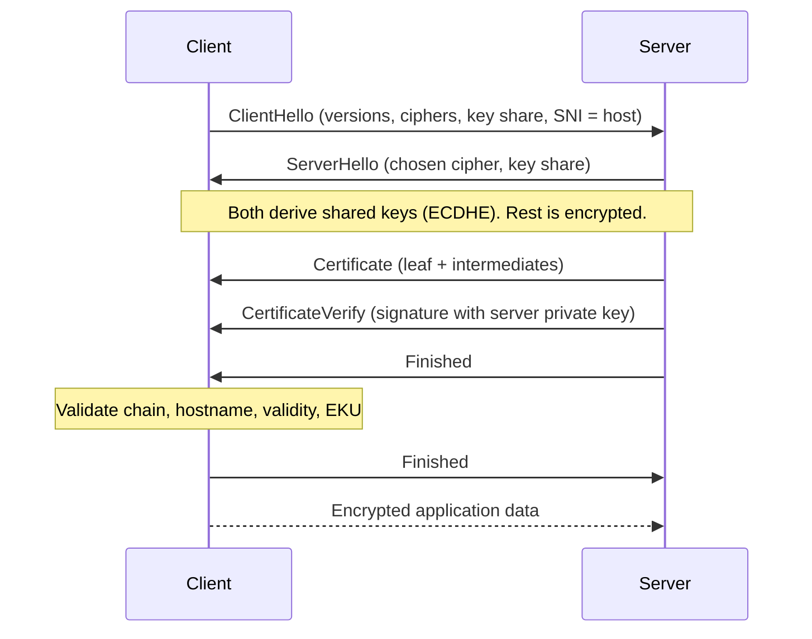
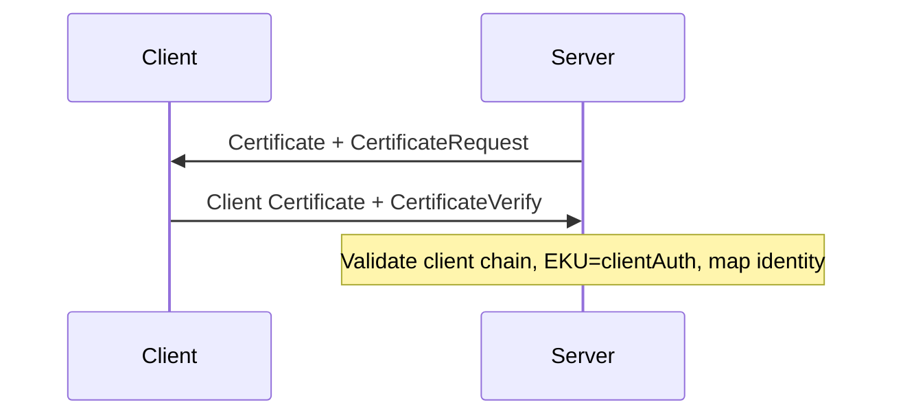

# 4. TLS and mTLS Flow

**Goal:** see exactly where certificates are presented and checked in a connection.

## Key ideas

TLS gives a connection **confidentiality, integrity, and authentication**. Certificates provide the authentication part.

### Simplified TLS 1.3 handshake (server auth)



What each part does:
- **SNI**: the client says which hostname it wants, so a server hosting many names can pick the right certificate.
- **Key shares (ECDHE)**: produce fresh session keys. This gives forward secrecy; stealing the server key later does not decrypt past traffic.
- **Certificate**: the server's chain.
- **CertificateVerify**: the server signs the handshake transcript with its **private key**. This is the proof of possession; a copied certificate alone is useless to an attacker.
- **Client validation**: the checks from [chapter 3](03-trust-and-chains.md), including verification of the certificate and `CertificateVerify`, happen before the client accepts the handshake. Failure means the connection must be aborted.

This diagram omits protocol details and optional features such as session resumption, 0-RTT, and ALPN. TLS provides an authenticated peer only when the relevant certificate authentication is enabled and successfully validated.

### Mutual TLS (mTLS)
In mTLS the server also sends a `CertificateRequest`; the client presents its own certificate and a `CertificateVerify`. The server validates it against a trust store (often a private CA) and typically maps a SAN-based certificate identity to an authorisation decision. The exact identity field should follow the protocol and issuance policy; do not rely on a legacy CN by default.



Use mTLS for service-to-service identity, where both ends need to prove who they are without passwords or API keys. Authentication identifies the peer; the application must still map that identity to an authorisation decision.

### Where TLS terminates
TLS may end at a load balancer, ingress, sidecar, or the app. Each hop is its own TLS session with its own certificates and trust. Know where yours ends and whether traffic behind it is re-encrypted.

### Client-side verification in code
```python
import ssl, urllib.request
ctx = ssl.create_default_context()                # system trust store, hostname checks on
ctx.load_verify_locations("internal-root.pem")    # add a private CA
ctx.load_cert_chain("client.pem", "client.key")   # only for mTLS
urllib.request.urlopen("https://svc.internal", context=ctx)
```

## Why it matters to you
Understanding the flow tells you which side is failing and why: server did not send intermediates, client does not trust the CA, name mismatch, client cert rejected, or clock skew.

## Common mistakes
- Disabling verification (`verify=False`, `InsecureSkipVerify`). This removes authentication entirely.
- Connecting by IP when the cert only has DNS names.
- Assuming mTLS equals authorisation; it only authenticates. You still must decide what each identity may do.

## Recap
- Key exchange creates session keys; the certificate and signature authenticate the peer.
- The server proves key possession via CertificateVerify.
- mTLS adds the same proof in the other direction.
